# Lab 1 — Result images

**USN:** 1BF24AI147  
**Dataset:** Fashion-MNIST subset (except the synthetic regression example)  
**Run:** 22 November 2026 — GitHub Actions quick mode

These are automatically generated images from an actual run of the scripts in this repository, not placeholder charts. The quick run used 1,000 Fashion-MNIST training images, 300 validation images and 500 held-out test images. The regularization experiments deliberately used only 400 training images.

## Main observations

| Experiment | Selected configuration | Best validation accuracy | Test accuracy |
| --- | --- | ---: | ---: |
| Optimizers | RMSprop with scheduled learning rate | 71.33% | 67.8% |
| Regularization | No regularization (short quick run) | 60.33% | 63.8% |
| Architecture | Residual MLP | 74.67% | 70.6% |

Selection used lowest validation loss. The plain MLP reached 71.67% validation accuracy versus 74.67% for the residual MLP on this quick run. The unregularized small-data model had training accuracy 70.0% and validation accuracy 60.33%, a 9.67 percentage-point gap. Early stopping was included but did not stop early within the seven-epoch quick run.

**Important:** These results are from the quick setting, so they are useful as an initial demonstration, not a conclusive full training study. Run **Actions → Generate Lab 1 result graphs → Run workflow → full** to rerun the longer experiments and replace the files with full-mode measurements.

## Gradient descent

### Batch, stochastic and mini-batch gradient descent

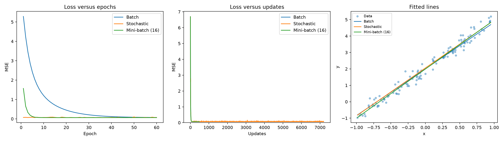

## Optimizer comparison

### Optimizer validation accuracy

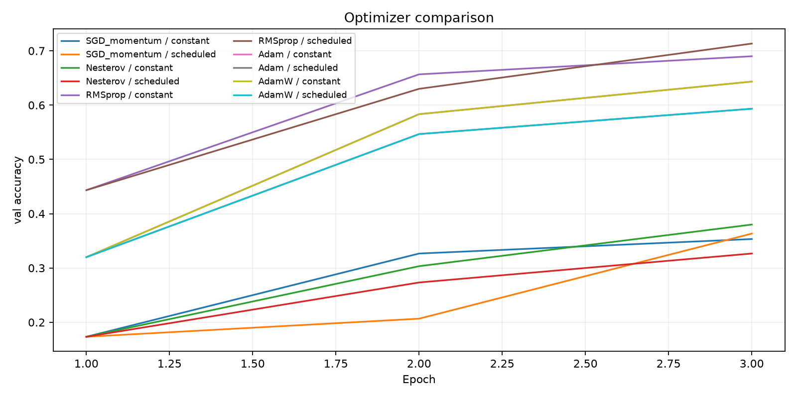

### Optimizer validation loss

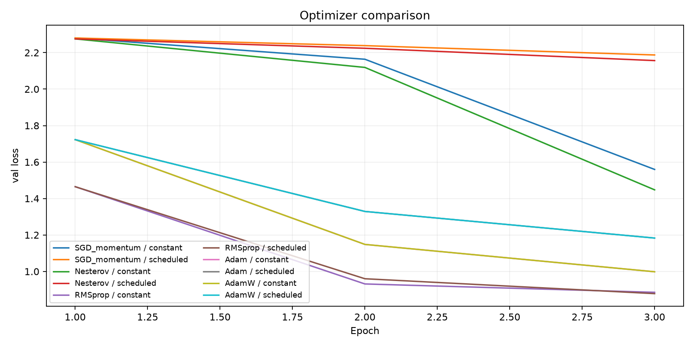

### Constant versus scheduled learning rates

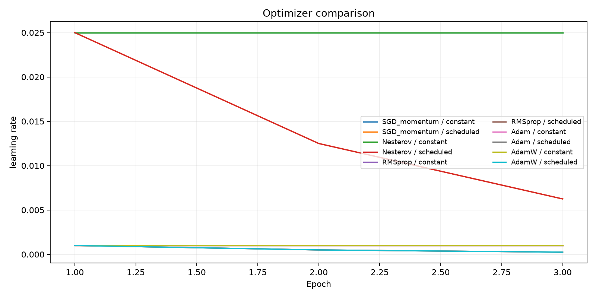

## Overfitting and regularization

### Training versus validation loss

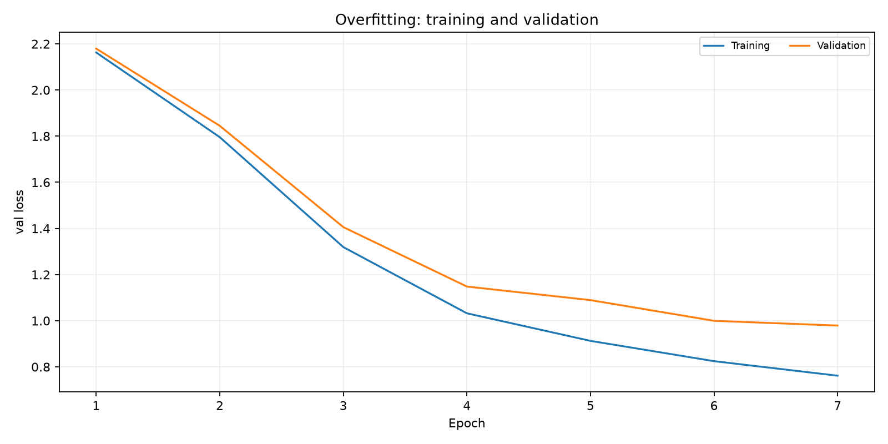

### Regularization validation accuracy

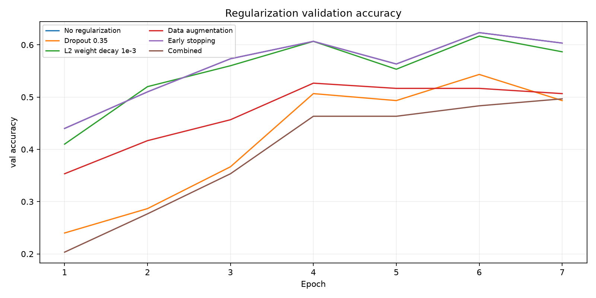

### Regularization validation loss

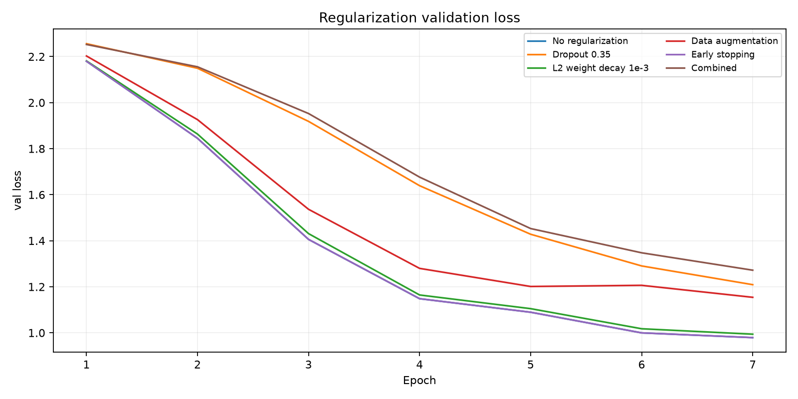

## Plain and residual MLP

### Plain versus residual MLP: accuracy

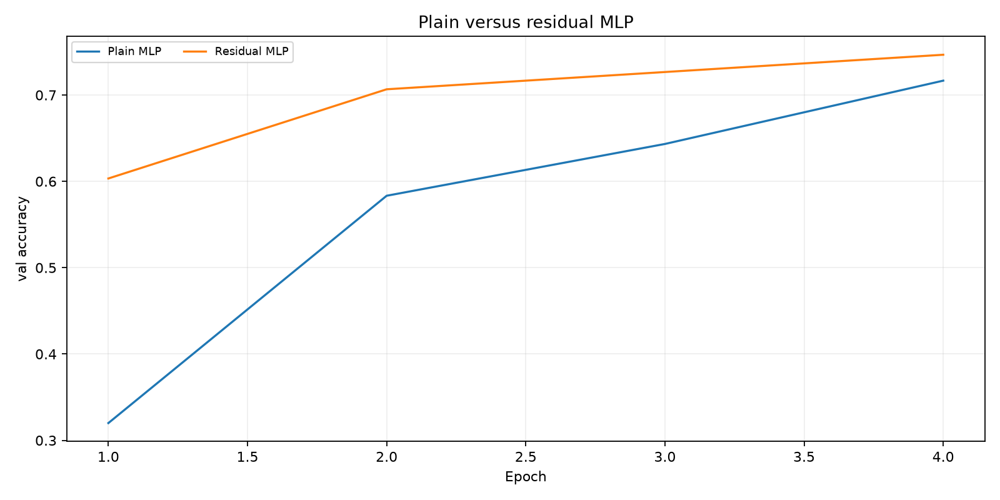

### Plain versus residual MLP: loss

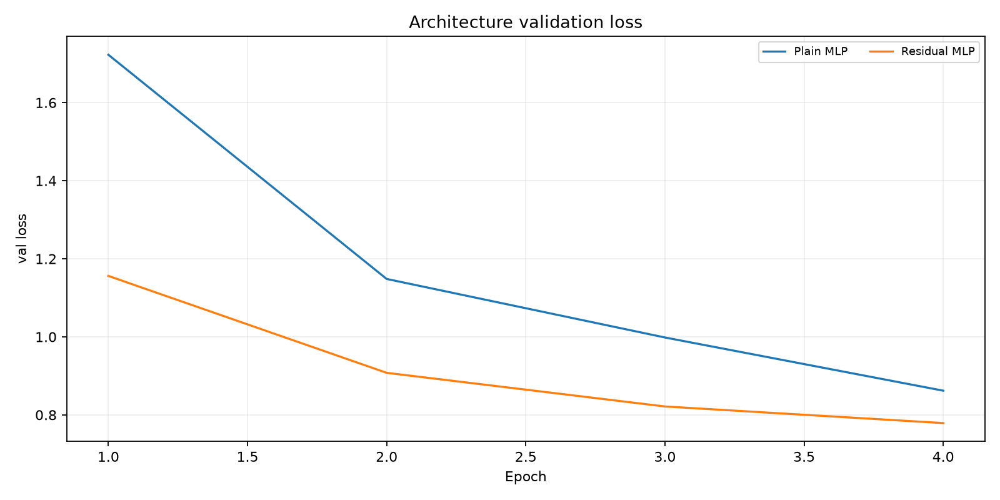

## Confusion matrices

### Confusion matrix of selected optimizer

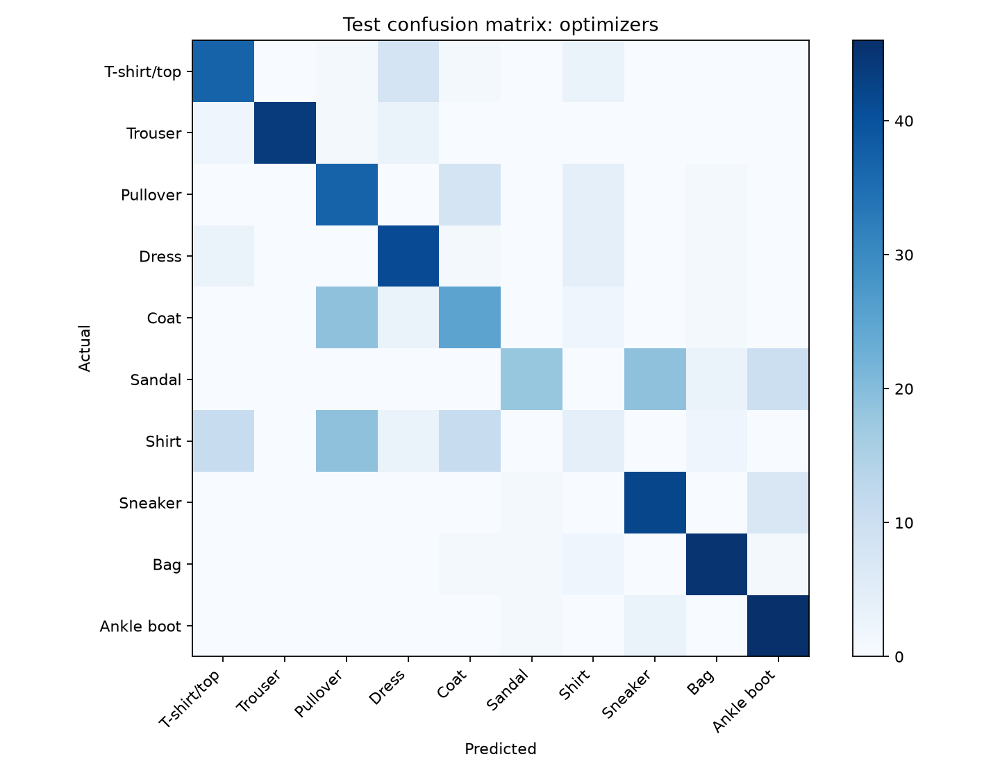

### Confusion matrix of selected regularization

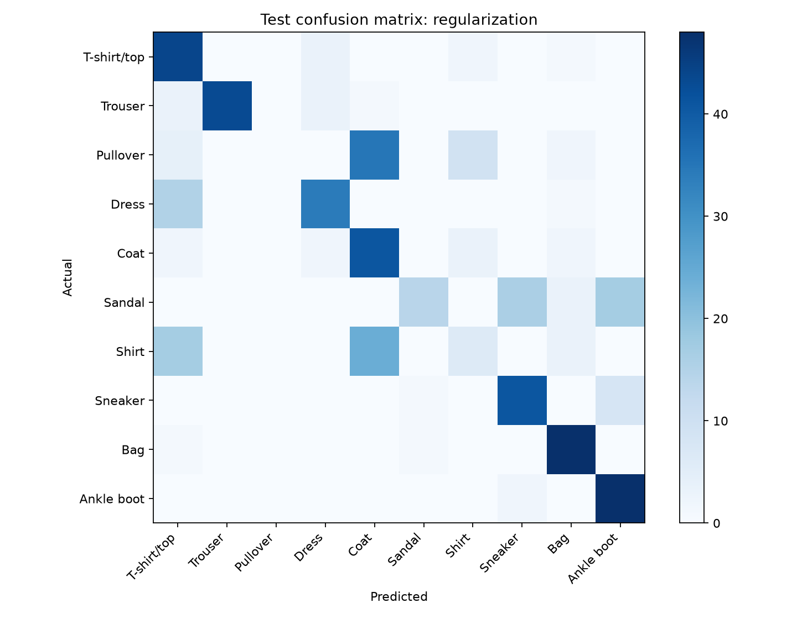

### Confusion matrix of selected architecture

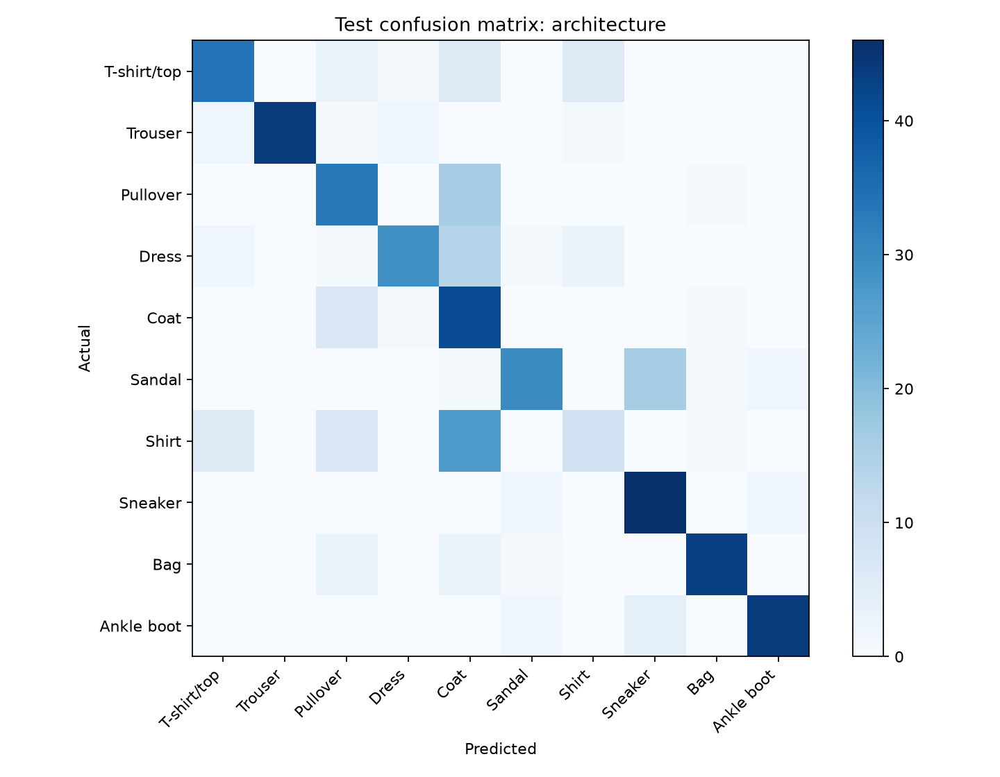

## Tables

- [Validation results for all 18 configurations](outputs/validation_results.csv)
- [Best models and held-out test accuracy](outputs/selected_test_results.csv)
- [Per-epoch metrics](outputs/epoch_histories.csv)
- [Classification metrics](outputs/class_metrics_architecture.csv)
